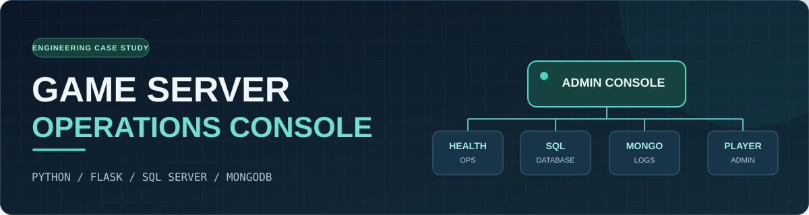

# 🎮 Game Server Engineering

**C++ Backend · SQL Server Performance · Live-Service Operations**

게임 서버를 운영하며 마주친 문제를 재현하고, 구조적 원인을 분석하고, 실제 코드와 도구를 개선해 온 기록입니다.

[**대표 프로젝트**](#-featured-work) · [**기술 사례**](#-case-studies) · [**기술 기록**](#-engineering-notes)

---

## 🚀 Featured Work

### [게임 서버 종합관리툴 — 상세 기술 소개 →](./projects/integrated-game-server-admin-tool/README.md)

**목표:** 기존 서버와 데이터 저장 구조를 유지하면서 분산된 점검·관리 작업을 하나의 웹 운영 콘솔로 통합했습니다.

| 운영 영역 | 직접 구현한 주요 기능 |
| :--- | :--- |
| **서버 점검·제어** | 환경별 상태 조회, 점검 체크리스트, 운영 명령 연동 |
| **SQL Server** | 용량/인덱스 관리, 백업, 환경 간 스키마·프로시저 비교 |
| **MongoDB** | 로그 검색·필터, 별칭, 인덱스 관리 |
| **유저·게임 데이터** | 계정·캐릭터·인벤토리 조회/관리, 바이너리 데이터 처리 및 규칙 검증 |

**설계에서 중요했던 세 가지 문제**

1. **기존 Binary DB와의 호환성:** 저장 성능·서버 호환성 제약 때문에 데이터를 Row 구조로 전면 전환하지 않고, 관리 계층에서 디코딩·검증·인코딩하는 방식을 선택했습니다.
2. **접근 경로 통제:** 여러 DB에 직접 연결하는 작업을 줄이고, 운영 환경 선택과 기능별 권한을 갖춘 관리 흐름을 구성했습니다. 관리 UI의 통합 자체가 네트워크 보안을 보장하지는 않습니다.
3. **점진적인 자동화:** 실제 운영 과정에서 필요한 기능을 발견할 때마다 추가했습니다. AI는 반복적인 코드 작성과 연동 구현을 돕는 도구로 활용했습니다.

[**아키텍처, 기능별 데모, 설계 이유와 한계 살펴보기 →**](./projects/integrated-game-server-admin-tool/README.md)

---

## 🔍 Case Studies

기능 목록보다 **문제의 배경, 검토한 대안, 검증 결과와 남은 한계**를 중심으로 정리한 사례입니다.

| Case Study | 핵심 내용 |
| :--- | :--- |
| **[Load/Save 패킷 통합과 부하 테스트](./case-studies/load-save-packet-consolidation.md)** | 저장 패킷 **21개 → 3개**로 통합. 내부 더미 테스트에서 병목 발생 구간 변화를 관찰했으며 재현 조건과 한계를 함께 기록 |
| **[TVP 제약을 우회한 JSON 배치 처리](./case-studies/sql-json-batch-fallback.md)** | 기존 OLE DB 연동 라이브러리의 TVP 활용 제약을 확인하고, JSON 기반 일괄 저장 흐름을 설계한 과정 |
| **[게임 서버 종합관리툴 설계](./projects/integrated-game-server-admin-tool/README.md)** | Binary 데이터 관리, 다중 DB 연동, 권한 관리, AI-assisted 개발을 통한 운영 도구 확장 |

> 위 실험의 측정값은 각 기록의 당시 환경과 조건에서 관찰한 결과이며, 일반적인 서비스 성능 개선율로 단정하지 않습니다.

---

## 📚 Engineering Notes

실제 개발 과정의 시행착오와 코드 비교를 포함한 **원본 작업 기록**입니다. 위 Case Study를 먼저 읽고, 근거와 구현 맥락이 필요할 때 참고하는 순서를 권장합니다.

| 분야 | 작업 기록 |
| :--- | :--- |
| DB 호출·저장 구조 | [DB최적화.md](./DB최적화.md) |
| 서버 코드·레거시 개선 | [개선된 사항.md](./개선된%20사항.md) |
| 업무 도구 개발 | [AI를 사용한 툴 제작.md](./AI를%20사용한%20툴%20제작.md) |
| AI 활용 개발 실험 | [AI코드 개발.md](./AI코드%20개발.md) |
| 성능 분석 원본 | [2025-09-25 Load 개선 기록](./DevReport/2025_09_25_Load개선.md) |
| 학습용 질의응답 | [DB관련.md](./DB관련.md) |

기타 참고 자료

- [개발 보고서 모음](./DevReport)
- [SQL 학습·관리 스크립트](./쿼리)

스크립트는 학습/참고 기록이며 실제 DB에서 사용하기 전 대상·영향 범위를 재검토해야 합니다.

---

## 🧭 Engineering Approach

**Observe → Reproduce → Measure → Improve → Verify → Document**

실제 운영의 문제를 분석할 때는 먼저 재현 조건과 근거를 찾고, 변경 후 동작을 검증합니다. 문제가 해결되지 않은 부분이나 충분히 측정하지 못한 부분도 구분해서 기록합니다.

공개 문서는 기술적 접근과 학습·개선 기록을 설명하기 위한 것입니다. 상용 환경의 구성·접속 정보 및 원본 운영 영상은 별도로 공유하지 않습니다.

[← GitHub Profile](https://github.com/rokMkiaz)

