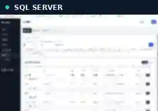
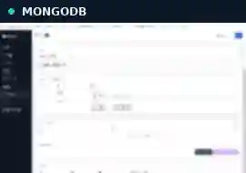

<div align="center">

# 🎮 Game Server Engineering Notes

**C++ Game Servers · SQL Server Optimization · Live Operations**

현업에서 직접 겪은 문제와 개선 경험을 기록하는 게임 서버 엔지니어링 포트폴리오입니다.


</div>

---

## 🚀 Featured Project: Integrated Game Server Management Tool

**📖 [Detailed Engineering Case Study →](./projects/integrated-game-server-admin-tool/README.md)**

운영 환경의 여러 관리 작업을 **하나의 UI로 통합**하기 위해 제작한 서버 종합관리툴입니다.
첨부된 시연 영상을 바탕으로 확인한 핵심 기능을 정리했습니다.

| Feature | Description |
| :--- | :--- |
| 🩺 **Comprehensive Check** | 여러 운영 대상과 관리 항목을 한 화면에서 종합 점검 |
| 🗃️ **SQL Server Management** | SQL Server 관련 데이터 조회와 관리 작업 |
| 🍃 **MongoDB Management** | MongoDB 연결, 데이터 조회 및 관리 화면 |
| 👤 **Player Administration** | 유저 검색, 상세 정보 확인 및 관리 기능 |

### 🎬 Animated previews

공개에 필요한 보안을 고려해 영상 일부를 **축약·저해상도·블러 처리**했습니다.

<table>
<tr>
<td width="50%" align="center"><strong>SQL Server Management</strong><br/></td>
<td width="50%" align="center"><strong>MongoDB Management</strong><br/></td>
</tr>
</table>

**Other recorded demonstrations:** Comprehensive Health Check / Player Administration.

> 원본 4개 MP4 영상은 운영 데이터 및 개인정보 노출 여부를 검토하기 전까지 공개하지 않습니다. 전체 영상은 마스킹 후 별도의 공개 영상 링크로 제공하는 것이 안전합니다.

### Engineering value

- **Centralized operations:** 분산된 업무를 통합 UI로 관리
- **Database workflows:** SQL Server와 MongoDB 작업을 한 도구에서 수행
- **Practical productivity:** 운영 점검 및 유저 관리의 반복 업무 간소화 지향
- **Security awareness:** 상용 시스템과 이용자 정보가 포함될 수 있는 시연 자료를 신중하게 공개

---

## 📚 Engineering Notes

| Topic | Notes |
| :--- | :--- |
| Database performance | [DB최적화.md](./DB최적화.md) |
| SQL Server development | [DB관련.md](./DB관련.md) |
| AI-assisted tool development | [AI를 사용한 툴 제작.md](./AI를%20사용한%20툴%20제작.md) |
| Legacy code and improvements | [개선된 사항.md](./개선된%20사항.md) |
| AI development notes | [AI코드 개발.md](./AI코드%20개발.md) |
| Technical development reports | [DevReport](./DevReport) |

**Main themes:** Stored procedures, excessive DB calls, batch processing, TVP, MERGE, query tuning, server debugging, legacy maintenance, internal tooling, and live-service operations.

---

## 🧭 Engineering Approach

```text
Observe → Reproduce → Measure → Improve → Verify → Document
```

기술적인 해결책만큼이나 **재현, 검증, 운영 안정성, 유지보수성**을 중요하게 생각합니다.

<sub>Commercial server source code and unredacted operational recordings are not published here. Project details describe demonstrated capabilities rather than unverified implementation claims.</sub>

<div align="center">

**[← GitHub Profile](https://github.com/rokMkiaz)**

</div>
