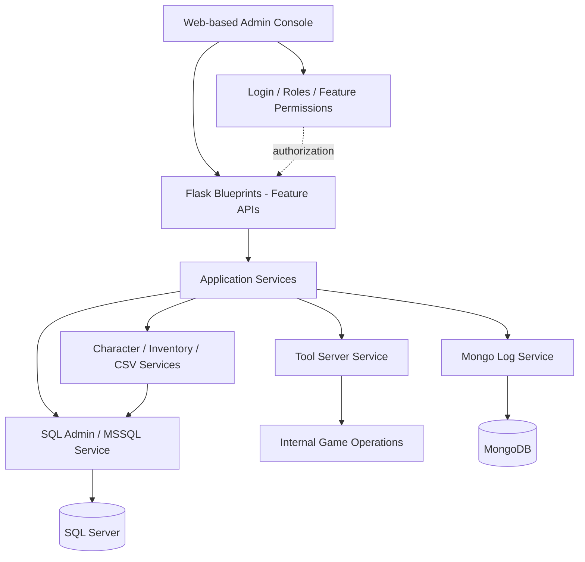

<div align="center">


# Integrated Game Server Management Tool
**게임 서버 종합관리툴 · Engineering Case Study**

게임 서버 운영 · SQL Server · MongoDB · 유저/아이템 관리 · 작업 자동화


[프로젝트 개요](#01--project-overview) · [설계 배경](#why-i-built-this--three-real-constraints) · [시연 및 기능](#02--features--demo) · [아키텍처](#03--architecture) · [구현 포인트](#04--engineering-highlights) · [트레이드오프](#05--design-decisions)

</div>

---

## 01 · Project Overview

> **여러 서버와 데이터베이스에 흩어진 운영 작업을 하나의 관리 콘솔로 통합한다.**

서버 상태 확인, 운영 명령 실행, 데이터베이스 점검, 로그 분석, 캐릭터·아이템 관리가 서로 다른 화면과 도구에 흩어지면 운영자는 작업마다 맥락을 전환해야 합니다.

여러 운영 작업을 **하나의 웹 관리 UI에서 수행하도록 Python 기반 내부 도구를 개발했습니다.** Flask Blueprint가 API를 담당하고 서비스 계층이 도메인 로직과 외부 시스템 연동을 처리합니다.

| 항목 | 내용 |
| :--- | :--- |
| **프로젝트 성격** | 게임 서버 운영자용 통합 관리자 도구 |
| **Framework** | Python · Flask |
| **Databases** | Microsoft SQL Server · MongoDB |
| **Architecture** | Blueprint(API) / Service(domain logic) / Backend adapter |
| **연동 대상** | 내부 Tool Server, SQL Server, MongoDB, 게임 데이터/CSV |
| **접근 관리** | 로그인·역할(Role)·메뉴/세부 기능별 권한·환경 선택 |

<sub>공개 가능한 범위에서 구현 기능과 설계 배경을 정리했습니다. 성능과 보안의 효과를 단정하기보다 실제로 해결한 문제와 남은 제약을 구분해 설명합니다.</sub>

---

## Why I Built This · Three Real Constraints

이 도구는 처음부터 거대한 관리 플랫폼을 설계한 프로젝트가 아닙니다. **기존 게임 서버와 데이터 구조를 유지해야 하는 상황에서, 운영상 반복되는 제약을 조금씩 해결하는 과정**에서 출발했습니다.

### 1. Binary 저장 구조를 유지하면서 데이터를 관리해야 했다

게임 아이템·인벤토리 데이터는 기존에 **고정된 바이너리 형태**로 DB에 저장되었습니다. 운영 중 이 데이터를 관계형 테이블의 행 단위 구조로 전면 전환하면 성능과 기존 서버 호환성에 부담이 생길 수 있었기 때문에, 저장 구조를 유지한 채 별도의 관리 인터페이스에서 **디코딩 → 조회·수정 → 검증 → 인코딩** 흐름을 제공해야 했습니다.

이는 저장 효율과 기존 시스템 호환성을 우선한 현실적인 선택이지만, **바이너리 포맷이 고정되면 필드 추가·크기 변경·버전 관리가 까다롭다**는 한계도 있습니다. 현재 도구 역시 이 제약을 완전히 해결하지는 못합니다.

**Trade-off:** 기존 저장 구조를 보존하는 대신, 관리 도구가 바이너리 레이아웃과 게임 데이터 규칙을 정확하게 이해하고 서버와 동기화해야 합니다.

### 2. 여러 DB를 관리하되 직접 접근 경로는 줄이고 싶었다

여러 환경과 DB를 각각의 도구로 관리하려면 운영자가 여러 연결 설정을 다루어야 합니다. 기존 운영 환경에서는 외부에 노출된 서비스 접근 경로와 관련한 보안 사고도 경험했고, 이에 따라 **운영자의 직접 DB 접근을 최소화하고 관리 경로를 통제할 필요성**이 커졌습니다.

종합관리툴은 이러한 운영 요구에 맞춰 **환경·대상 선택, 인증/역할/기능별 권한, 관리 작업의 단일 진입점**을 제공하도록 발전했습니다.

**Security boundary:** 관리 UI를 통합했다고 네트워크가 자동으로 안전해지는 것은 아닙니다. 실제 보안 수준은 DB의 비공개 네트워크 배치, 접근 제어, 인증 정보 보호, 작업별 권한 및 감사·검증 체계에 함께 의존합니다. 구체적인 운영 구성과 과거 사고 경로는 공개하지 않습니다.

### 3. AI-assisted 개발로 운영 도구를 점진적으로 확장할 수 있었다

과거에는 DB별 연동, 웹 API, 화면과 기능의 연결, 반복적인 보일러플레이트 작업을 개발자가 모두 직접 처리해야 했습니다. **AI를 개발 보조 도구로 활용**하면서 이런 연결 코드와 반복 작업의 구현 부담이 줄었고, 운영 중 필요한 점검·관리 기능을 하나씩 더하기 쉬워졌습니다.

중요한 점은 **무엇을 만들어야 하는지 정하는 기준은 실제 서버 운영 경험**이라는 것입니다. AI가 생성하거나 수정한 코드도 데이터 변경·서버 제어와 관련될 경우 사람이 동작과 권한을 검토해야 합니다.

**Evolution:** 미리 모든 기능을 결정하기보다, 현장에서 반복적으로 필요했던 작업을 발견할 때마다 모듈을 추가하는 형태로 성장했습니다.

---

## 02 · Features & Demo

### A. 🩺 Comprehensive Health Check & Server Operations

**목적:** 환경과 대상 서버를 확인하고 운영 작업을 집중 관리합니다.

- 환경 선택, 서버 목록 및 상태 조회
- 점검 체크리스트 상태 조회·변경
- Gate 잠금, 연결 사용자 종료, 서버 시작/종료 기능
- CSV 리로드, SVN 관련 점검, 운영 스크립트/SQL 배포 관련 기능

**설계 포인트:** 상태 조회와 서비스에 영향을 주는 명령은 위험도가 다릅니다. 서버 대상 식별, 실행 권한 및 결과 확인을 고려해야 하는 영역입니다.

### B. 🗄️ SQL Server Administration

<details>
<summary>실제 시연 미리보기 펼치기 (SQL Server)</summary>


<sub>공개 가능한 범위로 축소한 화면입니다. 실제 기능과 내부 운영 데이터는 상세 목록으로 설명합니다.</sub>

</details>

- DB 및 테이블 저장 용량 조회
- 인덱스 현황 및 전체 인덱스 요약
- 데이터베이스 백업(개별/일괄)
- 환경 간 스키마·저장 프로시저 비교
- SQL 파일 배치 실행 및 그룹별 배포 지원

**설계 포인트:** 여러 데이터베이스를 관리할 때 환경/대상을 명확히 분리하고, 배포·백업·비교 결과를 일관된 방식으로 다루는 것입니다. SQL Server 접근은 별도 서비스(`pymssql`)로 구성되어 있습니다.

### C. 🍃 MongoDB Log Explorer

<details>
<summary>실제 시연 미리보기 펼치기 (MongoDB)</summary>


<sub>공개 가능한 범위로 축소한 화면입니다. 실제 기능과 내부 운영 데이터는 상세 목록으로 설명합니다.</sub>

</details>

- 컬렉션·필드 탐색, 문서 검색 및 페이지 조회
- 검색 필터 저장/재사용과 날짜 필터 변환
- 컬렉션/필드 별칭 설정, 표시 순서 관리
- 인덱스 확인/생성 및 그룹별 인덱스 점검
- 로그 문서 평탄화와 조회 결과 가공

**설계 포인트:** 스키마가 유연한 로그 데이터를 운영자가 검색하기 쉬운 형태로 제공하며, 반복되는 검색 조건과 필드 표시 설정을 별도로 관리합니다.

### D. 👤 Player / Character Administration

- 계정·캐릭터 조회, 기본 정보 확인 및 수정
- 인벤토리·창고 데이터 조회 및 아이템 관리
- 게임 아이템 바이너리 데이터 디코딩/인코딩
- CSV 데이터에 근거한 아이템 옵션/범위 검증
- 계정 제한, 우편 발송 및 개인 우편함 관리
- 거래/상점 정보 조회, CCU/리텐션 통계 조회

**설계 포인트:** 게임의 바이너리 저장 구조와 게임 데이터 제약을 함께 이해해야 안전한 관리 UI를 구성할 수 있습니다.

### 🎬 About the demo videos

직접 촬영한 시연 영상은 **종합점검 · SQL Server 관리 · MongoDB 관리 · 유저 종합관리** 총 4개입니다. 운영 데이터나 식별 정보가 노출될 수 있어 원본 MP4는 공개하지 않았습니다. 이 페이지에는 저해상도 미리보기만 접어두었습니다. 전체 영상은 민감 정보 제거 후 별도 공개 링크를 연결할 수 있습니다.

---

## 03 · Architecture

**아래는 기능별 책임을 정리한 논리적 구성도입니다. 실제 네트워크·배포 토폴로지를 의미하지 않습니다.**



### 모듈 구성

| 모듈 계층 | 담당 역할 |
| :--- | :--- |
| **API / Blueprint** | 대시보드, 운영, SQL DB, 로그, 유저, 우편, 통계, 역할 관리 |
| **Core service** | 내부 운영 서버 연결, 환경 선택, 관리 명령 및 상태 처리 |
| **DB services** | MSSQL 쿼리·배포·백업·비교, MongoDB 로그 탐색·별칭·인덱스 관리 |
| **Game data services** | 캐릭터·인벤토리·창고·아이템 코덱, CSV 카탈로그 및 규칙 검사 |
| **Cross-cutting** | 인증, 계정·역할 관리, 기능 단위 권한, 환경별 설정 |

<details>
<summary><strong>요청 흐름 예시 보기</strong></summary>

```text
관리자가 대상/환경 선택
   ↓
로그인 및 기능 권한 확인
   ↓
Blueprint 요청/입력 처리
   ↓
Service에서 작업과 대상 결정
   ↓
DB 또는 내부 운영 서버 호출
   ↓
결과 확인 및 UI 표시
```

위는 이해를 돕기 위한 개념적인 흐름입니다. 모든 관리 기능이 동일한 구현 단계를 거치는 것은 아닙니다.

</details>

---

## 04 · Engineering Highlights

### 1. Modular Flask backend

기능별 Blueprint와 Service를 분리하여 운영·계정·데이터베이스·로그·통계 기능의 책임을 구분했습니다. 인증·권한 처리와 도메인별 외부 연동을 분리해 새로운 관리 기능을 추가할 수 있는 구조를 갖추고 있습니다.

### 2. SQL operations across environments

환경별 DB 대상 선택, 용량/인덱스 분석, 백업, 스키마/프로시저 차이 비교, SQL 스크립트 배포 등의 기능이 있습니다. 단순 SQL 실행기보다 **운영 DB 관리 업무 전반을 지원하는 서비스 계층**이 특징입니다.

### 3. Game-specific binary data codec

게임 아이템/인벤토리 데이터는 저장 성능과 기존 시스템 제약 때문에 **고정 바이너리 레이아웃을 유지한 상태로 관리**해야 했습니다. 이를 위해 바이너리 스키마, 아이템 인코드·디코드, CSV 데이터 기반 아이템 제약 검사를 별도 서비스로 분리했습니다.

핵심 과제는 바이너리를 읽을 수 있게 만드는 것뿐 아니라, **필드 추가나 포맷 변경이 필요할 때 기존 서버·DB·관리툴이 같은 레이아웃을 이해하도록 유지**하는 것입니다. 현재 고정 포맷의 확장성 문제는 남아 있습니다.

```text
Binary Data → Decode → Field / Rule Validation → Encode → Update
```

저장 구조를 사람이 이해 가능한 데이터로 변환하면서 게임 데이터 제약을 적용하는 부분이 핵심 구현 포인트입니다.

### 4. Structured MongoDB log exploration

문서 검색, 필터 검증, 날짜 처리, 필드 별칭/순서 및 인덱스 관리를 기능별로 분리하여 로그를 탐색하고 재사용 가능한 검색 조건을 관리하도록 구성했습니다.

### 5. Roles and feature-level permission checks

로그인·역할 관리와 함께 **메인 메뉴 및 세부 기능에 대한 권한 판별** 로직을 구현했습니다. 서버 운영과 데이터 수정처럼 민감도가 다른 기능을 하나의 도구에서 다룰 때 중요한 설계 요소입니다.

### 6. AI-assisted, operations-driven development

AI는 웹 API와 DB 연동, 반복적인 코드 작성과 기능 확장의 비용을 낮추는 **개발 가속 도구**로 활용했습니다. 실제 기능의 필요성과 우선순위는 서비스 운영에서 발생한 문제를 기준으로 결정했습니다. 특히 계정·아이템 수정이나 서버 제어 기능은 자동 생성 여부와 관계없이 권한·오류 처리·데이터 일관성 검토가 필요합니다.

---

## 05 · Design Decisions

| 결정 | 얻는 이점 | 고려할 부분 |
| :--- | :--- | :--- |
| **Preserve existing Binary DB** | 기존 서버 호환성 및 성능 요구를 고려하며 운영 데이터 관리 | 고정 레이아웃의 필드 확장·버전 관리가 어렵고 변환 로직 동기화 필요 |
| **Centralized operations entry point** | 여러 DB와 서버를 일관된 관리자 UI에서 다룸 | UI 통합과 별개로 네트워크 격리·접근 통제·감사 체계 필요 |
| **Blueprint + Service separation** | 기능을 점진적으로 추가하고 책임 분리 | 공통 설정/예외 처리 방식 통일 필요 |
| **Multiple backend adapters** | SQL Server·MongoDB·운영 서버 연동 통합 | 대상별 오류·실패 처리 분리 필요 |
| **AI-assisted development** | 반복적인 연동·화면·API 구현 부담 완화 | 결과 검증과 보안 검토는 별도 필요 |
| **Environment-aware targeting** | 운영 대상 환경의 선택과 구분 | 일괄 명령 전 대상 재확인이 중요 |

### Remaining Challenges & Next Engineering Goals

기능을 계속 늘리기보다 **바이너리 포맷 확장성·운영 안전성·회귀 검증**을 강화하는 것이 다음 과제입니다. 아래 항목은 구현 완료된 기능이 아니라 개선 방향입니다.

1. **Binary schema evolution:** 레코드 버전 식별, 포맷별 디코더, 이전 데이터와의 호환성 테스트. 가변 확장 데이터의 분리 저장 여부는 실제 성능 측정 후 검토
2. **Privileged operations safety:** 최소 권한, 변경성 작업의 감사 추적, 일괄 명령의 대상 확인·사전 미리보기와 승인 절차 강화
3. **Regression & failure handling:** 아이템 코덱/게임 규칙 검증 테스트, DB 배포·백업·서버 제어의 오류/복구 시나리오 점검
4. **Evidence-based improvements:** 반복 작업 시간, 점검 누락 및 조작 실수 감소를 실제 지표로 측정

**Lesson learned:** 운영 도구의 가치는 메뉴 개수가 아니라, 기존 시스템을 무너뜨리지 않고 운영 위험과 사람의 반복 작업을 줄이는 데 있습니다.

---

## 06 · Public Disclosure & Scope

이 페이지에는 **직접 구현한 관리 기능과 설계상 의사결정**을 공개 가능한 범위로 정리했습니다. 상용 게임 서버 코드, IP/호스트 정보, 비밀번호, 실제 사용자 데이터, 운영 설정, 상세 제어 프로토콜, 원본 영상은 공개하지 않습니다.

**핵심 경험:** 기존 Binary DB의 성능·호환성 제약을 고려하면서 SQL Server, MongoDB, 내부 서버 운영 및 게임 데이터 관리를 하나의 흐름으로 통합했습니다. AI를 반복적인 연동 코드 작성에 활용해 기능을 점진적으로 확장했으며, 바이너리 확장성과 운영 권한 통제는 계속 개선해야 할 과제로 남아 있습니다.

<div align="center">

---

[← Game Server Engineering Notes](../../README.md) · [Load/Save 패킷 개선](../../case-studies/load-save-packet-consolidation.md) · [JSON 배치 처리](../../case-studies/sql-json-batch-fallback.md) · [GitHub Profile](https://github.com/rokMkiaz)

**Observe → Reproduce → Measure → Improve → Verify**

</div>
