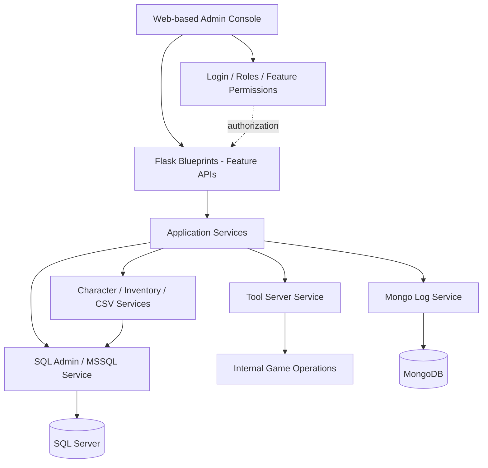

<div align="center">


# Integrated Game Server Management Tool
**게임 서버 종합관리툴 · Engineering Case Study**

게임 서버 운영 · SQL Server · MongoDB · 유저/아이템 관리 · 작업 자동화


[프로젝트 개요](#01--project-overview) · [시연 및 기능](#02--features--demo) · [아키텍처](#03--architecture) · [구현 포인트](#04--engineering-highlights) · [트레이드오프](#05--design-decisions)

</div>

---

## 01 · Project Overview

> **여러 서버와 데이터베이스에 흩어진 운영 작업을 하나의 관리 콘솔로 통합한다.**

서버 상태 확인, 운영 명령 실행, 데이터베이스 점검, 로그 분석, 캐릭터·아이템 관리가 서로 다른 화면과 도구에 흩어지면 운영자는 작업마다 맥락을 전환해야 합니다.

이 프로젝트는 이러한 운영 작업을 **하나의 웹 관리 UI에서 수행하도록 구성한 Python 기반 내부 도구**입니다. Flask Blueprint가 API를 담당하고 서비스 계층이 도메인 로직과 외부 시스템 연동을 처리합니다.

| 항목 | 내용 |
| :--- | :--- |
| **프로젝트 성격** | 게임 서버 운영자용 통합 관리자 도구 |
| **Framework** | Python · Flask |
| **Databases** | Microsoft SQL Server · MongoDB |
| **Architecture** | Blueprint(API) / Service(domain logic) / Backend adapter |
| **연동 대상** | 내부 Tool Server, SQL Server, MongoDB, 게임 데이터/CSV |
| **접근 관리** | 로그인·역할(Role)·메뉴/세부 기능별 권한·환경 선택 |

<sub>2026년 9월 말 소스 백업과 제공된 시연 영상 4개를 기준으로 작성한 기술 사례입니다. 성능 수치와 배포 효과는 검증 자료가 없어 기재하지 않았습니다.</sub>

---

## 02 · Features & Demo

### A. 🩺 Comprehensive Health Check & Server Operations

**목적:** 환경과 대상 서버를 확인하고 운영 작업을 집중 관리합니다.

- 환경 선택, 서버 목록 및 상태 조회
- 점검 체크리스트 상태 조회·변경
- Gate 잠금, 연결 사용자 종료, 서버 시작/종료 기능
- CSV 리로드, SVN 관련 점검, 운영 스크립트/SQL 배포 관련 기능

**Engineering focus:** 상태 조회와 서비스에 영향을 주는 명령은 위험도가 다릅니다. 서버 대상 식별, 실행 권한 및 결과 확인을 고려해야 하는 영역입니다.

### B. 🗄️ SQL Server Administration

<div align="center">

<br/>
<sub>첨부 시연 영상에서 추출한 저해상도·블러 미리보기</sub>
</div>

- DB 및 테이블 저장 용량 조회
- 인덱스 현황 및 전체 인덱스 요약
- 데이터베이스 백업(개별/일괄)
- 환경 간 스키마·저장 프로시저 비교
- SQL 파일 배치 실행 및 그룹별 배포 지원

**Engineering focus:** 여러 데이터베이스를 관리할 때 환경/대상을 명확히 분리하고, 배포·백업·비교 결과를 일관된 방식으로 다루는 것입니다. SQL Server 접근은 별도 서비스(`pymssql`)로 구성되어 있습니다.

### C. 🍃 MongoDB Log Explorer

<div align="center">

<br/>
<sub>첨부 시연 영상에서 추출한 저해상도·블러 미리보기</sub>
</div>

- 컬렉션·필드 탐색, 문서 검색 및 페이지 조회
- 검색 필터 저장/재사용과 날짜 필터 변환
- 컬렉션/필드 별칭 설정, 표시 순서 관리
- 인덱스 확인/생성 및 그룹별 인덱스 점검
- 로그 문서 평탄화와 조회 결과 가공

**Engineering focus:** 스키마가 유연한 로그 데이터를 운영자가 검색하기 쉬운 형태로 제공하며, 반복되는 검색 조건과 필드 표시 설정을 별도로 관리합니다.

### D. 👤 Player / Character Administration

- 계정·캐릭터 조회, 기본 정보 확인 및 수정
- 인벤토리·창고 데이터 조회 및 아이템 관리
- 게임 아이템 바이너리 데이터 디코딩/인코딩
- CSV 데이터에 근거한 아이템 옵션/범위 검증
- 계정 제한, 우편 발송 및 개인 우편함 관리
- 거래/상점 정보 조회, CCU/리텐션 통계 조회

**Engineering focus:** 게임의 바이너리 저장 구조와 게임 데이터 제약을 함께 이해해야 안전한 관리 UI를 구성할 수 있습니다.

### 🎬 About the demo videos

제공된 원본 시연 영상은 **종합점검 · SQL Server 관리 · MongoDB 관리 · 유저 종합관리** 총 4개입니다. 운영 데이터나 식별 정보가 노출될 수 있어 원본 MP4는 공개하지 않았습니다. 이 페이지에는 축약하고 흐리게 처리한 미리보기 두 개만 포함했습니다. 전체 영상은 민감 정보 제거 후 별도 공개 링크를 연결할 수 있습니다.

---

## 03 · Architecture

**아래 구성은 소스의 역할을 요약한 논리적 다이어그램으로, 실제 서버 네트워크/배포 구조를 나타내지 않습니다.**



### Modules identified in the private code

| 모듈 계층 | 담당 역할 |
| :--- | :--- |
| **API / Blueprint** | 대시보드, 운영, SQL DB, 로그, 유저, 우편, 통계, 역할 관리 |
| **Core service** | 내부 운영 서버 연결, 환경 선택, 관리 명령 및 상태 처리 |
| **DB services** | MSSQL 쿼리·배포·백업·비교, MongoDB 로그 탐색·별칭·인덱스 관리 |
| **Game data services** | 캐릭터·인벤토리·창고·아이템 코덱, CSV 카탈로그 및 규칙 검사 |
| **Cross-cutting** | 인증, 계정·역할 관리, 기능 단위 권한, 환경별 설정 |

<details>
<summary><strong>요청 흐름 예시 보기</strong></summary>

```text
관리자가 대상/환경 선택
   ↓
로그인 및 기능 권한 확인
   ↓
Blueprint 요청/입력 처리
   ↓
Service에서 작업과 대상 결정
   ↓
DB 또는 내부 운영 서버 호출
   ↓
결과 확인 및 UI 표시
```

위는 이해를 돕기 위한 개념적인 흐름입니다. 모든 관리 기능이 동일한 구현 단계를 거치는 것은 아닙니다.

</details>

---

## 04 · Engineering Highlights

### 1. Modular Flask backend

기능별 Blueprint와 Service를 분리하여 운영·계정·데이터베이스·로그·통계 기능의 책임을 구분했습니다. 인증·권한 처리와 도메인별 외부 연동을 분리해 새로운 관리 기능을 추가할 수 있는 구조를 갖추고 있습니다.

### 2. SQL operations across environments

환경별 DB 대상 선택, 용량/인덱스 분석, 백업, 스키마/프로시저 차이 비교, SQL 스크립트 배포 등의 기능이 있습니다. 단순 SQL 실행기보다 **운영 DB 관리 업무 전반을 지원하는 서비스 계층**이 특징입니다.

### 3. Game-specific binary data codec

게임 아이템/인벤토리는 일반적인 테이블 CRUD보다 복잡할 수 있습니다. 코드에는 별도 바이너리 스키마, 아이템 인코드·디코드, CSV 데이터 기반 아이템 제약 검사 서비스가 구분되어 있습니다.

```text
Binary Data → Decode → Field / Rule Validation → Encode → Update
```

저장 구조를 사람이 이해 가능한 데이터로 변환하면서 게임 데이터 제약을 적용하는 부분이 핵심 구현 포인트입니다.

### 4. Structured MongoDB log exploration

문서 검색, 필터 검증, 날짜 처리, 필드 별칭/순서, 인덱스 조회·생성을 개별 관리 기능으로 제공해 로그의 검색성과 운영 편의성을 개선하려는 설계가 확인됩니다.

### 5. Roles and feature-level permission checks

로그인/역할 관리 외에 **메인 메뉴와 세부 기능에 대한 권한 판별** 로직이 있습니다. 서버 운영과 데이터 수정처럼 민감도가 다른 기능을 하나의 도구에서 다룰 때 중요한 설계 요소입니다.

---

## 05 · Design Decisions

| 결정 | 얻는 이점 | 고려할 부분 |
| :--- | :--- | :--- |
| **One admin console** | 운영 도구 전환 비용 감소 | 강한 접근 통제와 권한 관리 필요 |
| **Blueprint + Service separation** | 책임 분리와 기능 확장 | 공통 설정/예외 처리 방식 통일 필요 |
| **Multiple backend adapters** | 이질적 시스템 관리 통합 | 실패 원인과 대상 시스템별 오류 구분 필요 |
| **Binary codec and constraints** | 게임 데이터를 의미 있는 관리 단위로 표현 | 데이터 버전·아이템 규칙 불일치 위험 |
| **Environment-aware targeting** | 운영 대상 환경의 선택과 구분 | 일괄 명령 전 대상 재확인이 중요 |

### Next Engineering Goals

아래는 **향후 개선 과제**이며, 현재 구현 기능이라고 주장하지 않습니다.

- 변경성 작업의 세부 감사 추적 및 승인 흐름 강화
- 일괄 명령의 Dry-run / 대상 미리보기
- SQL 배포·백업 및 서버 제어의 장애/복구 테스트
- 바이너리 코덱 버전별 회귀 테스트
- 실제 사용자 작업 시간 및 오류율 측정

---

## 06 · Public Disclosure & Scope

이 페이지는 **비공개 소스코드의 실제 구조와 시연으로 확인한 기능**을 바탕으로 기술 역량을 설명합니다. 상용 게임 서버 코드, IP/호스트 정보, 비밀번호, 실제 사용자 데이터, 운영 설정, 상세 제어 프로토콜, 원본 영상은 공개하지 않습니다.

**이 프로젝트가 보여주는 경험:** Python 웹 개발 자체보다 **게임 서버 운영 도메인을 기반으로 SQL Server, MongoDB, 내부 서버 제어와 게임 데이터 처리를 하나의 흐름으로 설계하고 구현한 경험**입니다.

<div align="center">

---

[← Game Server Engineering Notes](../../README.md) · [My GitHub Profile](https://github.com/rokMkiaz)

**Observe → Reproduce → Measure → Improve → Verify**

</div>
